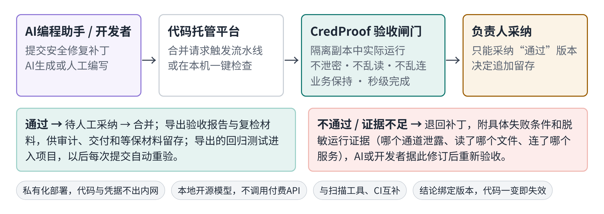
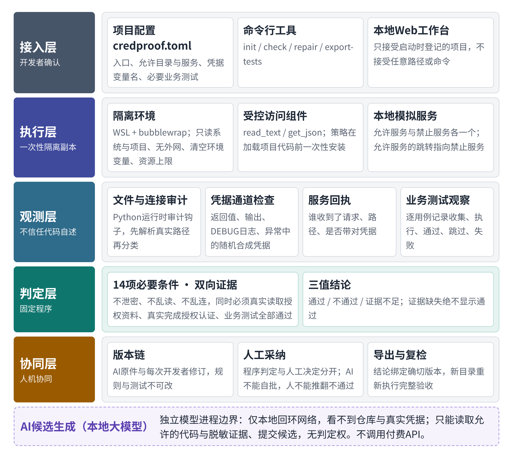
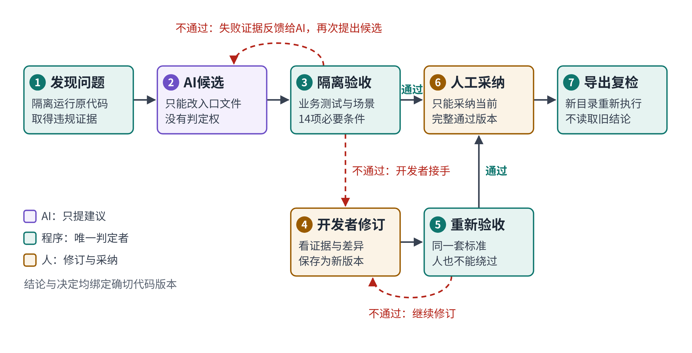
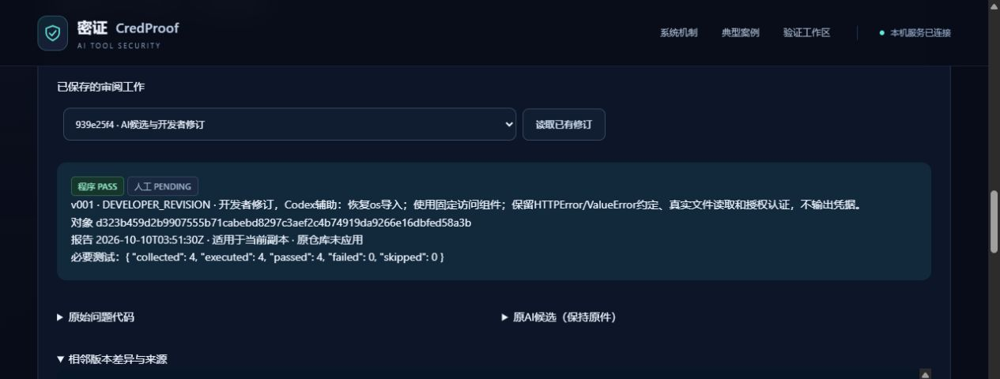
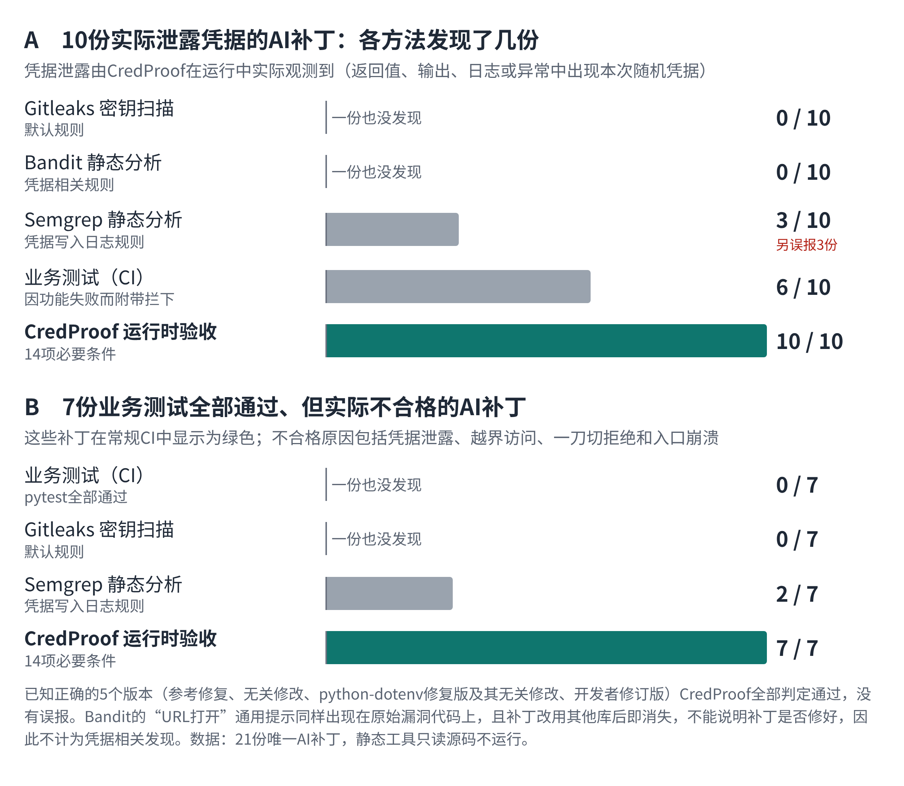
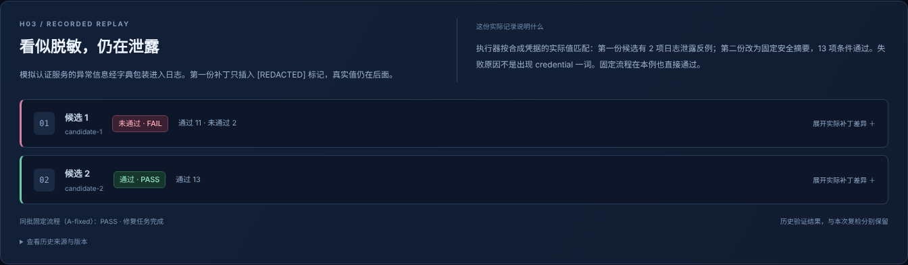

# 密证 CredProof——AI生成安全补丁的可信验收与人机协同修复平台

## 摘要

AI编程助手已经大规模进入软件开发，但AI生成的安全补丁能否被信任，目前缺少可靠的验收手段。公开研究显示，大模型在45%的编码任务中引入安全缺陷；2025年公开代码中新增泄露密钥2865万个，同比增长34%。现有手段各有盲区：密钥扫描与静态分析看不到运行时的凭据输出和越界访问，业务测试全部通过也不代表补丁安全。

密证CredProof是面向AI安全补丁的可信验收闸门。它在一次性隔离副本中实际运行补丁，同时检查凭据泄露、越界读取、未授权连接三类风险和必要业务行为，给出通过、不通过、证据不足三种结论；结论绑定补丁的确切版本，代码一变即失效，并可在新环境重新执行复检。平台把AI候选、开发者修订、程序验收、人工采纳串成闭环：AI不能批准自己的补丁，人也不能推翻程序的不通过结论。

在21份真实AI补丁上，CredProof未放行任何一份，其中7份业务测试全部通过；10份实际泄露凭据的补丁，密钥扫描发现0份，静态分析凭据规则仅发现3份。已知正确的5个版本全部通过，无误报。单次验收中位数1.6秒，本地运行，代码与凭据不出本机，可直接作为研发流水线门禁。

**关键词：** AI生成代码；安全补丁验收；凭据泄露；人机协同；可复检

## 第一章 作品概述

### 1.1 背景：AI在写补丁，谁来验收AI

AI编程工具已经成为开发者的日常工具。Stack Overflow 2025年开发者调查（超过4.9万名受访者）显示，84%的开发者正在使用或计划使用AI工具，高于上一年的76%[3]；IDC报告显示，国内AI编程助手对开发者的覆盖率约为30%，市场正进入快速增长期[5]。与此同时，同一调查中46%的开发者不信任AI输出的准确性，比上一年的31%明显上升[3]。

AI生成代码的安全风险已有大量实证。Veracode 2025年对100多个大模型、80项编码任务的测试表明，模型在45%的任务中引入了安全缺陷，其中日志注入类问题的失败率高达88%[2]。学术研究也发现，GitHub Copilot在安全相关场景生成的程序中约40%存在漏洞[7]。GitGuardian《2026密钥泄露态势报告》统计，2025年公开GitHub新增泄露密钥2865万个，同比增长34%；与AI服务相关的密钥泄露同比增长81%；由AI编程助手Claude Code协助完成的提交，密钥泄露率为3.2%，约为全部公开提交基线（1.5%）的2倍[1]。IBM《2025数据泄露成本报告》显示，全球单次数据泄露平均成本为444万美元，发生泄露的受访组织中63%尚无AI治理策略[4]。2025年10月，《网络安全法》修改决定通过，自2026年1月1日起施行，明确提出加强人工智能的风险监测评估和安全监管[6]。

一个现实问题摆在每个引入AI编程助手的团队面前：**AI说“已修复”，凭什么相信？**

### 1.2 痛点：三种“看起来修好了”

我们在让本地大模型实际修复漏洞的过程中，反复观察到三种具有迷惑性的AI补丁（数据见第三章）：

1. **表面修复，隐蔽泄露。** AI删除了日志里的凭据，代码审阅和原有业务测试都通过，但函数返回值里仍带着凭据，还会跟随服务器跳转，把认证信息发往未授权的服务。
2. **一刀切的假修复。** AI让程序拒绝所有文件和网络访问。不再泄密、不再越界，4项业务测试也全部通过，但工具已经不读取应该读取的资料、也不访问应该访问的服务，实际功能被破坏。
3. **业务全绿，安全不过。** 在开源项目python-dotenv上，带缺陷的代码117项业务测试全部通过，却仍会读取授权目录之外的密钥文件，并把凭据写进返回结果。

这三种情况，密钥扫描、静态分析和常规CI测试都很难发现：凭据来自环境变量，代码中没有硬编码；泄露发生在运行时；业务测试只验证“该做的做了”，不验证“不该做的没做”。

### 1.3 作品定位

密证CredProof定位为**AI生成安全补丁的可信验收闸门**：

- **对AI补丁：** 不信任AI的自述，只信任在隔离环境中实际运行得到的证据；
- **对开发者：** 提供可修订、可追溯的工作台，AI修不好时由人接手，人的修订同样必须通过验收；
- **对团队与审计：** 每个结论都绑定到确切的代码版本，可导出、可在新环境重新执行；代码变化后，旧结论和旧审批自动失效。

一句话概括：**让AI提出修复，让程序决定是否接受，让人决定是否采纳，让任何人都能复查。**

### 1.4 目标用户与应用场景

| 用户 | 典型场景 | CredProof提供的价值 |
|---|---|---|
| 引入AI编程助手的企业研发团队 | 合并前对AI生成或AI修改的安全相关代码设置门禁 | 运行时证据验收，阻止“看起来修好了”的补丁进入主干 |
| 企业安全团队、安全服务商 | 漏洞修复后的复测与交付验收 | 秒级自动复测，输出可导出、可复检的验收材料 |
| AI编程工具与Agent平台厂商 | 评估模型生成补丁的真实可用率 | 统一、可重复的补丁质量评测基准 |
| 金融、政务等数据外传敏感单位 | 不允许源代码和凭据上传云端 | 本地模型、本地隔离执行，代码与凭据不出本机 |

**一个典型使用过程。** 某团队的AI编程助手为一个内部数据工具提交了“修复日志泄露”的合并请求，代码审阅看起来没有问题，CI全部通过。流水线随后调用CredProof：补丁在隔离副本中运行，结果发现凭据仍出现在函数返回值中，而且工具会跟随一次跳转，把认证头发往未授权地址。CredProof判定不通过，并把失败条件和脱敏证据附在合并请求上。AI或开发者据此修订，新版本通过全部14项条件后进入“待人工采纳”；负责人采纳后合并，验收报告与复检材料归档，供审计和交付使用。导出的回归测试留在项目里，以后每次提交都会重新验收。



### 1.5 核心功能

| 功能 | 说明 |
|---|---|
| 一键接入 | 在项目中生成`credproof.toml`，声明入口、允许目录与服务、凭据变量名和必要业务测试 |
| 隔离验收 | 在一次性隔离副本中运行业务测试与安全场景，检查凭据泄露、越界读取、未授权连接 |
| 三值判定 | 通过、不通过、证据不足；证据缺失时绝不显示通过 |
| AI候选修复 | 本地大模型基于运行证据提出补丁，不调用付费API |
| 开发者修订 | 网页中查看AI原件、版本差异和验收报告，提交修订版本 |
| 人工采纳 | 程序判定与人工决定分开记录；AI不能自批，人不能推翻不通过 |
| 导出复检 | 导出补丁、规则、依赖和报告，可在新目录重新执行完整验收 |
| 回归测试导出 | 生成可放入项目CI的pytest回归测试，以后每次提交自动重新验收 |

### 1.6 商业价值与推广路径

**市场机会。** AI编程助手渗透率快速上升，国内开发者覆盖率约30%且仍在快速增长[5]；与此同时，AI相关密钥泄露一年增长81%[1]。现有代码安全产品主要面向人写的代码，以静态扫描为主。“AI补丁上线前的可信验收”是一个随AI编程普及而出现、尚未被充分覆盖的新环节。

**客户为什么需要。**
1. **降低风险成本：** 一次数据泄露的平均成本为444万美元[4]，而一次CredProof验收的耗时以秒计；
2. **把人工复测变成自动门禁：** 安全团队不必逐个复测AI补丁，只需审阅程序判定为“通过”的版本；
3. **满足合规与审计：** 本地运行，数据不出域；每个结论都有可复检的材料，便于留存和第三方复查，契合《网络安全法》对人工智能风险监测评估的新要求[6]。

**产品形态与商业模式。**

| 形态 | 面向对象 | 内容 | 收费方式 |
|---|---|---|---|
| 开源社区版 | 个人开发者、高校、开源项目 | 命令行、本地工作台、基础规则 | 免费，用于获取用户与反馈 |
| 企业版 | 企业研发与安全团队 | 私有化部署、CI/CD合并门禁插件、多项目管理、审批流、审计报表、规则库 | 按项目或席位订阅 |
| 评测服务 | AI编程工具与大模型厂商 | 补丁真实可用率的标准化评测与报告 | 按评测项目收费 |

**竞争优势。** 与静态扫描相比，CredProof看的是补丁运行时的真实行为；与AI自动修复工具相比，它是独立于AI的裁判，并要求补丁保留业务功能；与人工复测相比，它是秒级、可重复、可留证的。它与现有扫描工具和CI是互补关系，可以直接接入现有流程。

**推广路径。** 第一阶段，在高校与开源社区推广社区版，积累规则与案例；第二阶段，以“AI编程安全门禁”切入已采购AI编程助手的企业，优先金融、政务等数据敏感行业；第三阶段，扩展到更多语言和风险类型，并与AI编程平台合作提供补丁评测服务。

## 第二章 作品设计与实现

### 2.1 总体架构



系统分为五层：

1. **接入层：** 项目配置文件`credproof.toml`、命令行工具和本地Web工作台。配置由开发者确认；网页只能选择启动时登记的项目，不接受任意路径或命令。
2. **执行层：** 每次验收复制一份一次性项目副本，在WSL与bubblewrap[10]构建的隔离环境中运行。隔离环境只读挂载系统和项目，无外网，清空环境变量，并限制CPU、内存、文件和进程数。
3. **观测层：** 在被测代码之外独立记录运行行为，包括Python审计钩子记录的文件访问和网络连接、两个本地模拟服务（允许服务与禁止服务）的请求回执、DEBUG级日志，以及标准输出、错误输出、返回值和异常中是否出现本次随机生成的合成凭据。
4. **判定层：** 固定程序根据14项必要条件计算结论。条件由人工预先确定，AI和网页都无法修改。
5. **协同层：** 版本链、开发者修订、人工决定、导出与复检。所有结论和决定都绑定到确切的代码版本。

AI模型运行在独立的模型进程边界内：只有本地回环网络，外网连接被阻断，看不到项目仓库和真实凭据，只能通过受控接口读取允许的代码与证据并提交候选。

### 2.2 验收闸门工作流程



1. **发现问题：** 程序在隔离副本中运行原始代码，取得凭据泄露、越界读取或未授权连接的运行证据。只有存在真实违规证据时才开放修复。
2. **AI提出候选：** 本地模型读取允许的代码和脱敏证据，提交候选补丁。模型只能修改登记的入口文件，不能修改测试、配置、规则或访问组件。
3. **程序验收：** 候选补丁进入新的隔离副本，重新运行全部业务测试和安全场景。验收失败的事实可以反馈给模型，由模型再次提出候选。
4. **开发者修订：** AI修不好时，开发者在工作台查看AI原件、失败证据和差异，提交修订版本。修订保存为新版本，不覆盖AI原件。
5. **重新验收：** 修订版本必须通过同一套验收，开发者也不能绕过。
6. **人工采纳：** 程序通过后，状态为“待人工决定”。人工可以采纳、拒绝或要求修改；程序未通过的版本不能被采纳。
7. **导出与复检：** 导出补丁、配置、测试、访问组件和报告；在任何新目录中都可以重新执行完整验收，而不是读取保存的结论。

### 2.3 关键技术一：双向证据判定

传统安全检查只问“有没有做坏事”。CredProof同时要求“必须做了该做的事”，14项必要条件分为四组：

| 类别 | 必要条件 | 防止的问题 |
|---|---|---|
| 业务保持 | 业务测试全部收集、执行并通过；入口正常完成；每个声明的场景得到预期结果 | 补丁破坏业务、测试被跳过 |
| 不泄密 | 返回值、输出、日志、异常中均不出现合成凭据 | 隐蔽通道泄露 |
| 不乱读 | 没有读取禁止目录或范围外文件；**必须实际读取了允许文件** | 越界读取；一刀切拒绝 |
| 不乱连 | 禁止服务没有收到请求、没有未授权连接；**必须带凭据成功访问允许服务**；访问路径在允许前缀内 | 跳转泄露；一刀切拒绝 |

结论分为三种：

- **通过：** 全部必要条件满足；
- **不通过：** 存在明确反例，例如凭据出现在日志里、禁止服务收到了请求；
- **证据不足：** 隔离环境不可用、观测字段缺失、必要测试未执行或全部跳过，或者某个需要网络的场景在发出任何请求之前就报错。

最后一点很关键：AI补丁常常因为提前报错而“看起来”没有访问禁止服务。CredProof把这种情况判为证据不足，而不是安全。

### 2.4 关键技术二：行为级运行时观测

| 风险 | 观测方式 |
|---|---|
| 凭据泄露 | 每次验收随机生成合成凭据并注入环境变量；检查返回值、标准输出、错误输出、DEBUG级日志、异常信息中是否出现 |
| 越界读取 | Python运行时审计钩子[9]记录每次文件打开，先解析真实路径再分类，覆盖`../`穿越、符号链接、绝对路径等绕过方式 |
| 未授权连接 | 两个独立的本地模拟服务分别代表允许与禁止的目标；允许服务的`/redirect`会跳转到禁止服务，用于发现跟随跳转的泄露 |
| 业务行为 | 内置pytest观察插件，按用例记录收集、执行、通过、跳过、失败，不依赖解析文本输出 |

观测脚本由受信程序在加载项目代码之前安装；凭据值和原始输出只保留在本地，导出报告自动脱敏。

### 2.5 关键技术三：受控访问组件

AI补丁失败的一个常见原因，是自己实现路径校验和跳转处理时出错。CredProof提供固定的访问组件`credproof_access`，只有两个函数：`read_text(path)`在解析真实路径后只允许读取授权目录；`get_json(url, credential)`只允许带凭据访问授权服务，且从不跟随跳转。访问策略由隔离环境在加载项目代码前一次性安装，请求和模型都无法修改。

组件把“正确的安全写法”变成可复用的基础能力：开发者或AI只需正确调用，安全边界由组件保证。组件本身的版本与摘要也纳入验收绑定，组件变化会使旧结论失效。

### 2.6 关键技术四：结论与版本绑定的人机协同

| 机制 | 实现 |
|---|---|
| 版本链 | AI原件为第0版，每次开发者修订保存为新版本，记录父版本、来源、理由和代码摘要 |
| 不可变规则 | 修订只能改登记的入口文件；测试、配置、组件与冻结基线逐字节比对 |
| 结论绑定 | 验收报告记录项目树摘要；当前代码与报告不一致时，结论自动变为证据不足 |
| 防过期操作 | 每次修订、验收、审批、导出都必须携带当前版本、对象摘要、报告摘要和决定数量，任何一项不一致即拒绝 |
| 审批约束 | 只有当前完整通过的版本可以采纳；重新验收后旧批准不会自动恢复；决定只追加、不覆盖 |
| 导出复检 | 导出包含补丁、规则、依赖、报告和清单；复检时先核对清单，再在新目录完整执行，不读取保存的结论 |

### 2.7 接入与部署

开发者接入只需四步：

```
python -m credproof_safety init --project . --write
python -m credproof_safety check --config credproof.toml
python -m credproof_safety repair --strategy bounded_patch --config credproof.toml
python -m credproof_safety export-tests --config credproof.toml --output tests/credproof-regression
```

第四步导出的回归测试可以直接放进项目的pytest和CI流程。平台以Python wheel安装；查看、修订、审批不需要GPU；隔离验收使用Windows配合WSL环境；AI候选生成使用本地Qwen2.5-Coder 32B量化模型[8]，单张消费级显卡即可运行，不调用任何付费API。



## 第三章 作品测试与分析

### 3.1 测试环境与样本

| 项目 | 配置 |
|---|---|
| 硬件 | 单台工作站，RTX 5090显卡 |
| 隔离环境 | Windows + WSL Ubuntu 24.04 + bubblewrap，审核过的只读根文件系统 |
| 软件 | Python 3.12、pytest 8.4.2 |
| 模型 | 本地qwen3-coder:30b、qwen2.5-coder:32b-instruct（Q4_K_M）[8]，经Ollama运行 |
| 被测项目 | 资料助手（含凭据泄露、越界读取、跟随跳转三类缺陷，4项业务测试）；开源项目python-dotenv v1.2.2（114项上游测试＋3项适配测试）[11] |
| 对比工具 | Gitleaks 8.28.0、Bandit 1.8.6、Semgrep 1.180.0（社区规则python与密钥两个目录，共562个规则文件）[12] |

所有凭据都是每次随机生成的合成值，所有服务都是隔离环境内的本地模拟服务，不涉及真实账户。全部补丁源码、原始验收报告和统计脚本随作品提供，可逐条核对。

### 3.2 实验一：21份真实AI补丁的验收对比

**样本。** 开发过程中，本地大模型在五种修复策略下（工具调用Agent、上下文预算控制、受限补丁生成、组件辅助生成、失败反馈修订）共产生21份不同的AI补丁（按源码摘要去重），其中19份针对资料助手，2份针对python-dotenv。补丁全部来自真实模型输出，没有人为构造或挑选。

**结果一：没有一份AI补丁被放行。** 21份补丁中，CredProof判定不通过20份、证据不足1份（语法错误，业务测试无法执行），通过0份。与之对照，已知正确的5个版本（参考修复、无关修改、python-dotenv修复版及其无关修改、开发者修订版）全部判定通过，没有误报。

**结果二：业务测试和静态工具大量漏判。**



| 指标 | 结果 |
|---|---|
| 业务测试全部通过（CI显示绿色）的AI补丁 | 21份中有7份，即三分之一；**7份全部被CredProof判定不通过** |
| 实际泄露凭据的AI补丁（运行中出现本次随机凭据） | 10份 |
| 其中被Gitleaks密钥扫描发现 | 0份 |
| 其中被Semgrep凭据日志规则发现 | 3份；该规则另对3份并未泄露的补丁误报 |
| 三种静态工具均无任何告警、但实际不合格的AI补丁 | 3份（含1份同时泄露凭据并越界读取的补丁） |

Bandit对多数补丁给出“使用了URL打开函数”的通用提示，但该提示同样出现在原始漏洞代码上，补丁换用其他库后即消失，不能说明补丁是否修好。

**7份“业务全绿”补丁为什么不合格：**

| 不合格原因 | 份数 | 说明 |
|---|---|---|
| 凭据仍然泄露 | 4 | 写入DEBUG日志、放进返回值或标准输出 |
| 越界读取或访问禁止服务 | 2 | 包括跟随跳转把认证头发往禁止服务 |
| 一刀切拒绝 | 1 | 不再读取授权资料、不再完成授权认证 |
| 入口在攻击场景下崩溃 | 2 | 业务测试覆盖不到的输入导致异常 |

（一份补丁可能有多个原因。）

**典型案例。**

1. **删掉日志，凭据却在返回值里。** 一份AI补丁删除了日志中的凭据，在当时只有3项业务测试的规则下全部通过。CredProof随后新增“正常返回”和“跳转”两个场景，对同一份保存的补丁重新验收，发现它把凭据放在返回结果中，并会跟随服务器跳转访问禁止服务，判定不通过。
2. **早期规则漏掉的日志泄露。** 另一份补丁曾在早期版本中通过验收；观测层加入DEBUG级日志捕获后，对保存的同一补丁复检，发现凭据被写入日志，判定不通过。这两个案例说明：结论与补丁版本绑定、材料可以重新执行，规则升级后就能对旧的“通过”重新把关。
3. **一刀切的假修复。** 一份AI补丁的4项业务测试全部通过，没有泄密、没有越界，三种静态工具也都没有告警。但CredProof发现它根本没有读取允许的资料文件，也没有向允许服务完成认证，判定不通过。
4. **外部项目上的越界读取。** 在python-dotenv上，一份AI补丁业务测试全部通过，但仍读取禁止目录中的密钥文件并把凭据写进返回值；三种静态工具均无告警。
5. **格式错误。** 一份补丁把Markdown代码块标记写进了源码，导致语法错误、业务测试无法执行。CredProof判为证据不足，而不是通过。

**结论。** 真实AI补丁中“看起来修好了”的情况普遍存在：三分之一的补丁能让CI显示绿色，多数凭据泄露是静态工具看不到的。只有在隔离环境中实际运行、同时检查“不该做的”和“该做的”，才能可靠拦截。

### 3.3 实验二：开源项目python-dotenv——业务全绿不等于安全

在python-dotenv v1.2.2（BSD-3-Clause）[11]上人工注入一个越界读取缺陷，用四个版本对照：

| 版本 | 业务测试 | CredProof判定 |
|---|---|---|
| 注入缺陷版 | 116通过、1失败 | 不通过 |
| 修复版 | 117项全部通过 | 通过 |
| 修复后重新引入缺陷 | **117项全部通过** | **不通过**（越界读取、凭据进入返回值） |
| 无关修改 | 117项全部通过 | 通过 |

第三行是最直接的证据：业务测试全部通过、CI显示绿色，但工具仍在读取授权目录之外的密钥文件，而三种静态工具对这个注入缺陷都没有告警。第四行说明CredProof不会因为代码出现无关变化而误报。

### 3.4 实验三：人机协同修复闭环

在资料助手上完整走通一次“AI候选→程序验收→开发者修订→重新验收→人工采纳→导出复检”：

| 步骤 | 结果 |
|---|---|
| AI候选 | 缺少导入并错误转换异常类型，4项业务测试仅1项通过，判定不通过 |
| 开发者修订 | 恢复导入，改用受控访问组件，保留真实文件读取、服务认证和异常约定 |
| 重新验收 | 4项业务测试全部执行并通过，0项跳过；14项必要条件全部满足；判定通过 |
| 人工状态 | 待人工决定，原仓库未被自动修改 |
| 审批约束测试 | 未通过的版本无法采纳；通过的版本可以拒绝；过期页面、错误版本被拒绝；代码、配置、组件或必要测试变化后，旧批准与采纳导出全部失效。共记录21次真实HTTP操作，其中11次不安全请求被后端拒绝 |
| 导出复检 | 导出17个文件，从代码仓库匿名取回后，在全新目录重新执行完整验收，判定通过 |
| 回归测试 | 导出的pytest回归测试在修复版、重新引入缺陷版、无关修改版上分别得到通过、不通过、通过 |

这一闭环说明：AI修不好时，人可以接手；人的修订同样必须通过程序验收，人的采纳决定同样受版本绑定约束。

### 3.5 实验四：失败反馈帮助AI改进

在历史合成案例h03中，AI的第一份补丁把凭据前缀替换成`[REDACTED]`，但真实值仍留在消息末尾，13项条件中2项不通过。CredProof把两条日志泄露反例反馈给模型后，第二份补丁改为输出固定的安全文本，13项条件全部通过。在8个留出案例的对照中，固定修复流程、一次性模型生成、带反馈的模型Agent对问题样例的合格修复分别为3/4、1/4、4/4。运行证据反馈能提升AI修复质量，但AI补丁仍需要独立验收把关。



### 3.6 性能与开销

| 指标 | 结果 |
|---|---|
| 单次完整验收耗时（45份真实验收报告，小型项目） | 中位数1.6秒，90%在2.4秒以内，最长4.3秒 |
| 外部项目验收 | python-dotenv 117项测试在单次隔离验收中完成 |
| 模型资源 | 32B量化模型，单张消费级显卡；查看、修订、审批与复检无需GPU |
| 外部依赖 | 不调用付费API；模型进程无外网连接 |

秒级的验收速度意味着CredProof可以作为每次提交、每份AI补丁的常规门禁，而不是事后的人工复测。

### 3.7 测试小结

1. 21份真实AI补丁无一被放行，已知正确的5个版本全部通过；
2. 三分之一的AI补丁能让业务测试全部通过，但全部存在安全或功能问题；
3. 10份实际泄露凭据的补丁，密钥扫描发现0份，静态分析凭据规则发现3份；
4. 规则升级后对保存补丁重新验收，发现了2份早期被放行的补丁的问题；
5. 人机协同闭环完整可用，验收为秒级，可以直接接入日常开发流程。

## 第四章 创新性说明

### 4.1 与现有方案的对比

| 能力 | 密钥扫描 | 静态分析 | 单元测试/CI | AI自动修复工具 | 本作品 |
|---|---|---|---|---|---|
| 发现运行时凭据泄露（返回值、日志、异常） | 否 | 部分 | 否 | 部分 | **是** |
| 发现越界读取与跟随跳转 | 否 | 部分 | 否 | 部分 | **是** |
| 识别“一刀切”式假修复 | 否 | 否 | 部分 | 否 | **是** |
| 同时确认业务行为保持 | 否 | 否 | 是 | 部分 | **是** |
| 结论绑定代码版本、可导出复检 | 否 | 否 | 否 | 否 | **是** |
| AI不能自批，人工采纳与程序判定分离 | 不适用 | 不适用 | 不适用 | 否 | **是** |
| 本地运行，代码不出本机 | 是 | 是 | 是 | 多为云端 | **是** |

### 4.2 创新点一：面向AI补丁的“双向证据”验收

现有安全检查关注“有没有做坏事”。CredProof把“必须做了该做的事”（实际读取授权资料、实际完成授权认证）与“没有做不该做的事”同时作为补丁通过的必要条件，并用“证据不足”把“没有测到”与“确实安全”区分开。这一设计专门针对AI补丁的典型失败方式：一刀切拒绝、提前报错、表面脱敏。实验一中的一刀切补丁与语法错误补丁都因此被正确拦截，而静态工具对前者没有任何告警。

### 4.3 创新点二：“AI提出、程序判定、人工采纳”的三权分离闭环

CredProof把修复过程中的三种权力分开：AI只有提出候选的权力；程序拥有判定权，规则和测试不能被AI或网页修改；人拥有采纳权，但不能推翻程序的不通过结论。开发者修订与AI候选进入同一条版本链、经过同一套验收。团队因此可以放心用AI提高修复效率，而不必把安全判断交给AI本身。

### 4.4 创新点三：结论与版本强绑定的可复检交付

每份验收报告、每个审批决定、每个导出包都绑定到确切的代码、配置、测试与访问组件。代码变化后旧结论自动失效；重新验收不会恢复旧批准；复检时在新目录重新执行完整验收，而不是读取保存的“通过”。实验一中，规则升级后正是依靠这一机制，对保存的补丁重新把关，发现了早期被放行的2份补丁的问题。交付给他人的不是一句“已修复”，而是任何人都能重新验证的证据。

### 4.5 创新点四：把安全写法沉淀为受控组件

受控访问组件把正确的路径校验与跳转处理固化为两个函数，访问策略由隔离环境在加载项目代码前一次性安装，AI与开发者只需正确调用。这降低了AI补丁的出错面，也让同一套安全规则可以在多个项目间复用。

## 第五章 总结

### 5.1 作品总结

密证CredProof回答了AI编程时代的一个关键问题：AI说“已修复”，凭什么相信。它以隔离环境中的运行证据替代AI自述，以双向证据判定识别表面修复和假修复，以版本绑定和复检保证结论可信、可交付，以三权分离闭环让AI、程序和人各司其职。在21份真实AI补丁、开源项目python-dotenv和完整人机协同流程上的测试表明，CredProof能够发现业务测试和静态工具普遍漏掉的问题，没有误报，且验收速度足以作为日常开发门禁。

### 5.2 适用范围与局限

当前版本支持已适配的Python工具，每个项目配置一个授权目录、一个禁止目录和一个本地授权服务；隔离验收依赖Windows与WSL环境；观测基于Python运行时审计，尚未覆盖原生系统调用、子进程与竞态条件。所有测试使用合成凭据与本地模拟服务。验收报告中的摘要用于识别材料变化，不等同于第三方认证或数字签名。本地模型独立修复的成功率仍然有限，这正是平台采用“AI提出、程序判定、人工采纳”设计的原因。

### 5.3 后续计划

1. **能力扩展：** 支持多个授权目录和服务、子进程观测，扩展到JavaScript/TypeScript与Go；
2. **产品化：** 提供GitHub/GitLab合并门禁插件，支持Linux原生隔离环境与容器部署；
3. **生态合作：** 面向AI编程工具与大模型厂商开放补丁验收评测基准，为AI生成代码安全提供统一度量。

## 参考文献

[1] GitGuardian. The State of Secrets Sprawl 2026: AI-Service Leaks Surge 81% and 29M Secrets Hit Public GitHub[EB/OL]. (2026-03)[2026-10-12]. https://dev.to/gitguardian/the-state-of-secrets-sprawl-2026-ai-service-leaks-surge-81-and-29m-secrets-hit-public-github-2bgj.

[2] Veracode. AI-Generated Code Poses Major Security Risks in Nearly Half of All Development Tasks, Veracode Research Reveals[EB/OL]. (2025-07-30)[2026-10-12]. https://www.veracode.com/press-release/ai-generated-code-poses-major-security-risks-in-nearly-half-of-all-development-tasks-veracode-research-reveals/.

[3] Stack Overflow. Stack Overflow's 2025 Developer Survey Reveals Trust in AI at an All Time Low[EB/OL]. (2025-07-29)[2026-10-12]. https://stackoverflow.co/company/press/archive/stack-overflow-2025-developer-survey/.

[4] IBM. Cost of a Data Breach Report 2025[R/OL]. 2025[2026-10-12]. https://www.ibm.com/reports/data-breach.

[5] IDC. AI Coding市场迎来爆发期，IDC发布中国市场代码生成产品评估[EB/OL]. (2025-06-03)[2026-10-12]. https://www.idc.com/?p=104455.

[6] 新华社. 引导AI发展！网络安全法完成修改[EB/OL]. (2025-10-28)[2026-10-12]. https://www.news.cn/politics/20251028/b3400522666a4b3f8c844b9fa6c31131/c.html.

[7] PEARCE H, AHMAD B, TAN B, et al. Asleep at the Keyboard? Assessing the Security of GitHub Copilot's Code Contributions[C]//2022 IEEE Symposium on Security and Privacy (SP). San Francisco: IEEE, 2022: 754-768.

[8] HUI B, YANG J, CUI Z, et al. Qwen2.5-Coder Technical Report[EB/OL]. (2024-09-18)[2026-10-12]. https://arxiv.org/abs/2409.12186.

[9] DOWER S, HEIMES C. PEP 578 – Python Runtime Audit Hooks[EB/OL]. (2018)[2026-10-12]. https://peps.python.org/pep-0578/.

[10] Containers. Bubblewrap: Low-level unprivileged sandboxing tool[CP/OL]. [2026-10-12]. https://github.com/containers/bubblewrap.

[11] KUMAR S. python-dotenv v1.2.2[CP/OL]. BSD-3-Clause. [2026-10-12]. https://github.com/theskumar/python-dotenv.

[12] Gitleaks; PyCQA Bandit; Semgrep Community Rules[CP/OL]. [2026-10-12]. https://github.com/gitleaks/gitleaks; https://github.com/PyCQA/bandit; https://github.com/semgrep/semgrep-rules.
